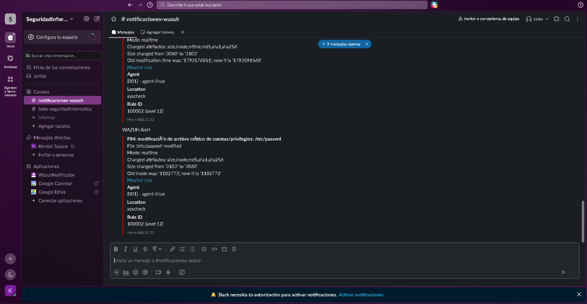
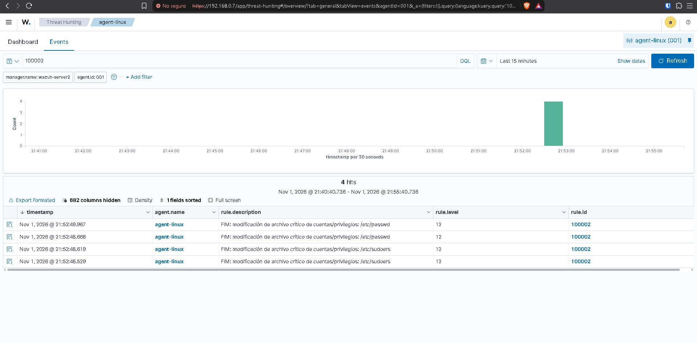
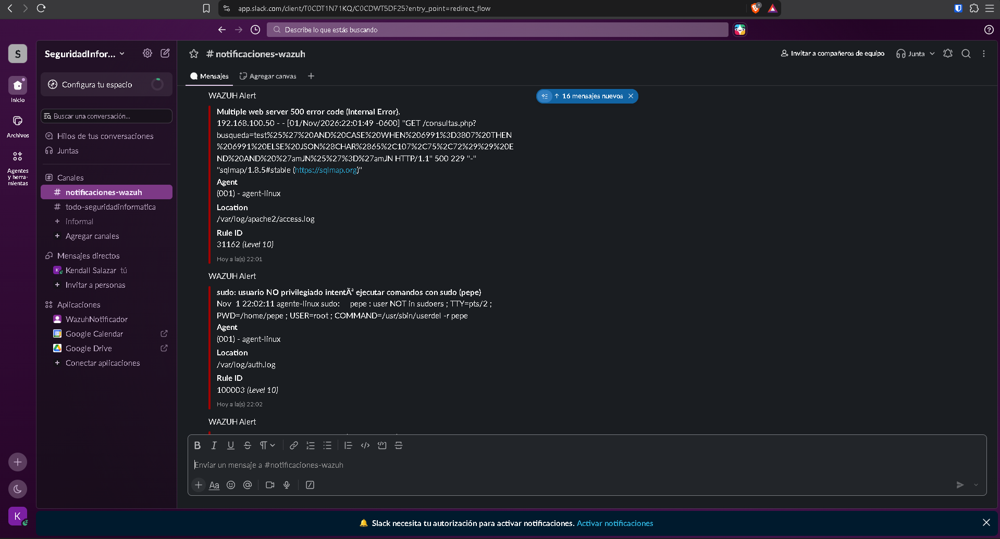
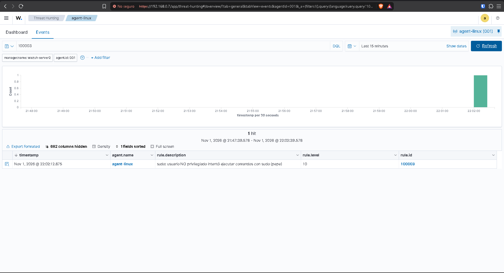
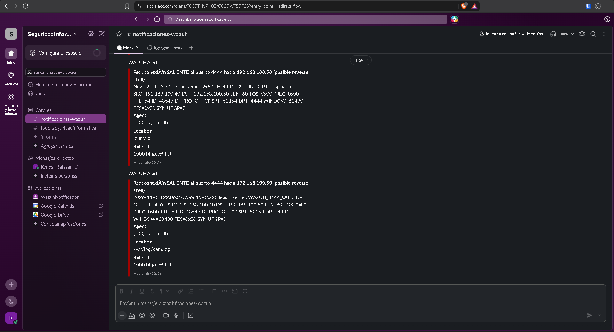
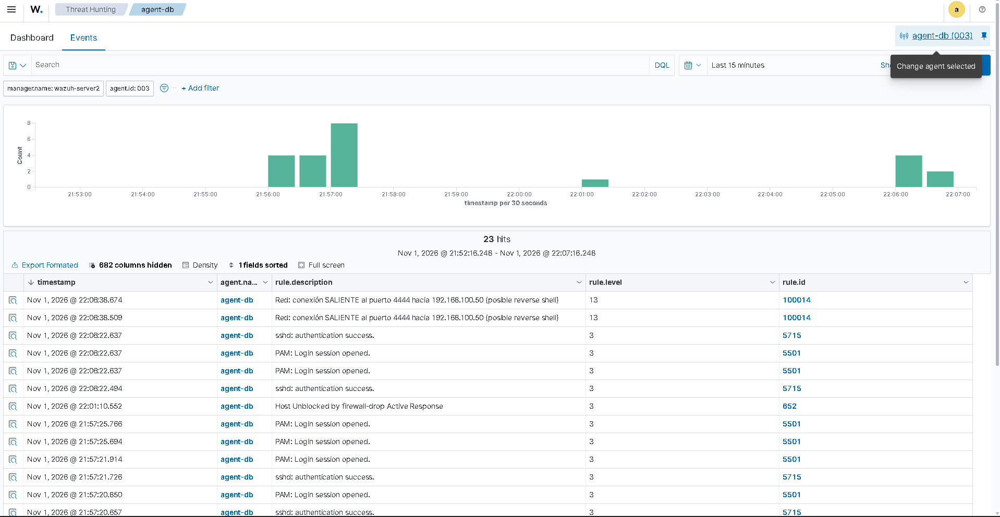
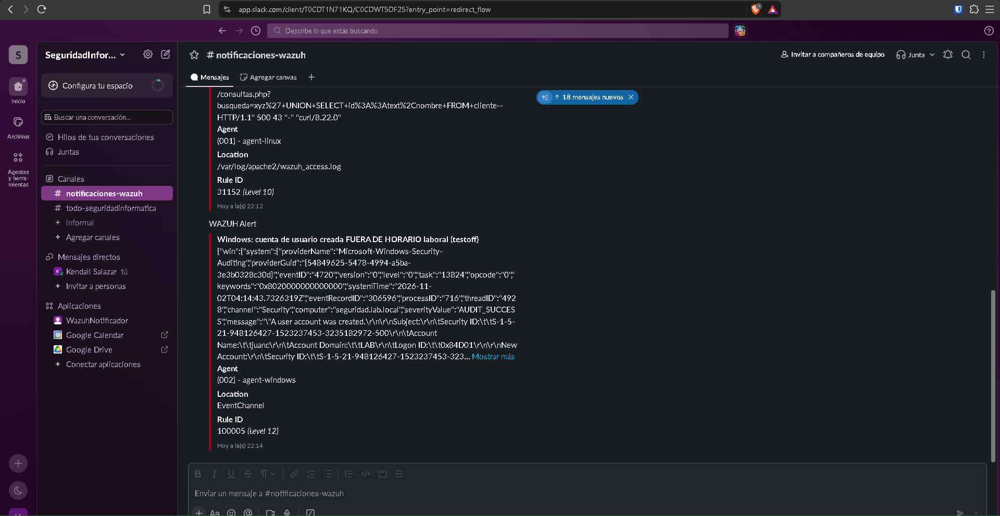
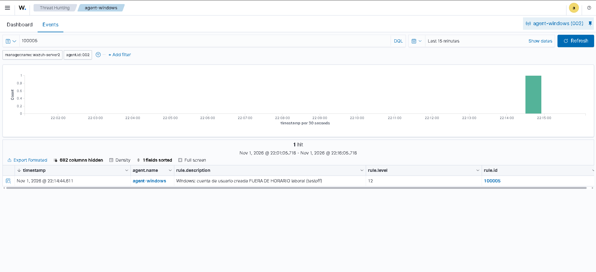

### Prueba rápida SIN atacar: `wazuh-logtest` (en wazuh-server)
```bash
sudo /var/ossec/bin/wazuh-logtest
```
Pega una línea, Enter. Debes ver `Phase 2: decoder` y `Phase 3: rule id`.

| Prueba | Línea a pegar | Esperado |
|---|---|---|
| Regla 1 (pégala **6 veces seguidas**) | `Oct 31 10:00:01 linux-server sshd[1234]: Failed password for root from 192.168.100.99 port 40000 ssh2` | A la 6ª: regla **100001** |
| Regla 3 | `Oct 31 10:00:01 linux-server sudo:     pepe : user NOT in sudoers ; TTY=pts/0 ; PWD=/home/pepe ; USER=root ; COMMAND=/usr/bin/ls` | **100003** |
| Regla 3b | `Oct 31 10:00:01 linux-server sudo:     pepe : TTY=pts/0 ; PWD=/home/pepe ; USER=root ; COMMAND=/usr/bin/cat /etc/shadow` | **100013** |
| Regla 4 | `Oct 31 10:00:01 linux-server kernel: [ 1234.567890] WAZUH_4444_IN: IN=enp0s3 OUT= MAC=08:00:27:aa:bb:cc:08:00:27:dd:ee:ff:08:00 SRC=192.168.100.99 DST=192.168.100.20 LEN=60 TOS=0x00 PREC=0x00 TTL=64 ID=1234 DF PROTO=TCP SPT=44444 DPT=4444 WINDOW=64240 RES=0x00 SYN URGP=0` | Decoder `wz-fw-port4444`, regla **100004** |
| Decoder Apache | `WZ-APACHE 192.168.100.99 - - [31/Oct/2026:10:00:00 -0600] "GET /index.php?id=1%27%20OR%201=1-- HTTP/1.1" 200 512 "-" "sqlmap/1.7.2#stable (https://sqlmap.org)"` | Campos `srcip`, `url`, `user_agent`; reglas **100021** y/o **100022** |
| Decoder PostgreSQL | `WZ-PG 2026-10-31 10:00:00.123 CST [4321] postgres@appdb 192.168.100.99 FATAL:  password authentication failed for user "postgres"` | Campos `srcuser`, `db`, `srcip`; regla **100031** |

### 1 Regla 1 — Fuerza bruta SSH (desde Kali)
Dentro de `<ossec_config>`, en la sección `</ossec_config>` se configuró el active response para la regla 100001 pero se podria agregar para la 100004 y 100021:
 
```xml
  <!-- ========= ACTIVE RESPONSE ========= -->
  <active-response>
    <command>firewall-drop</command>
    <location>local</location>
    <rules_id>100001</rules_id>
    <timeout>600</timeout>
  </active-response>
 
  <!-- Opcional: también bloquear conexión al puerto 4444 y SQLi web -->
  <active-response>
    <command>firewall-drop</command>
    <location>local</location>
    <rules_id>100004,100021</rules_id>
    <timeout>600</timeout>
  </active-response>
```

```bash
hydra -l root -P /usr/share/wordlists/rockyou.txt -t 4 ssh://192.168.100.20
# o manual: repetir 7 veces
for i in $(seq 1 7); do ssh -o StrictHostKeyChecking=no root@192.168.100.20 'exit'; done   # con contraseña incorrecta
```
Esperado: alerta **100001** (nivel 10). Funciona igual contra `agent-db` (192.168.100.40).

**Probar**
 
1. **Terminal 1 — agente atacado** (linux-server o agent-db): ver respuesta en vivo
```bash
   tail -f /var/ossec/logs/active-responses.log
```
2. **Terminal 2 — Kali:** lanzar el ataque
```bash
   hydra -l root -P /usr/share/wordlists/rockyou.txt -t 4 ssh://agente-linux@192.168.100.20
```
```bash
   hydra -l root -P /usr/share/wordlists/rockyou.txt -t 4 ssh://coni@192.168.100.40
```
3. **Qué debes ver:**
   - En el agente: líneas `firewall-drop ... add ... <IP_KALI>`.
   - Comprobar el bloqueo en el agente:
```bash
     iptables -L INPUT -n --line-numbers | head
```
     Debe aparecer `DROP all -- <IP_KALI> 0.0.0.0/0`.
   - Desde Kali, el ataque se queda sin respuesta (timeouts).
   - A los 10 minutos: línea `... delete ...` en el log y la regla desaparece.
4. **Desbloquear antes de tiempo** (si necesitas repetir el ataque):
```bash
   iptables -L INPUT -n --line-numbers          # busca el número de la línea DROP
   iptables -D INPUT <número>
```
### Lo que se muestra en el video:
 
1. Mostrar el bloque `<active-response>` en `ossec.conf` y la regla 100001.
2. Ejecución el comando de ataque en Kali(hydra) + agente siendo atacado (`tail -f active-responses.log`) + Dashboard (Threat Hunting → Events, filtro `rule.id:100001`)
3. Lanzar el ataque. Mostrar la alerta 100001 y el log del Active Response.
4. Mostrar `iptables -L INPUT -n` con el DROP a `<IP_KALI>`.
5. Mostrar en Kali que ya no puede conectar (`ssh root@<IP_LINUX_SERVER>` se queda colgado).

### 2 Regla 2 — FIM en `/etc/passwd` y `/etc/sudoers` (en linux-server)
```bash
# sudoers: agregar un comentario inofensivo
sudo cp /etc/sudoers /root/sudoers.bak
echo "# prueba FIM wazuh" | sudo tee -a /etc/sudoers
sudo visudo -c                                  # debe decir "parsed OK"
# Revertir:
sudo sed -i '/prueba FIM wazuh/d' /etc/sudoers

# passwd: crear y borrar un usuario de prueba
sudo useradd -m testfim
sudo userdel -r testfim
```
Esperado: alertas **100002** (nivel 12) en segundos.


### 3 Regla 3 — sudo por usuario no privilegiado (en linux-server)
```bash
sudo useradd -m pepe && sudo passwd pepe
su - pepe
sudo ls /root            # responde "pepe is not in the sudoers file"
exit
sudo userdel -r pepe
```
Esperado: alerta **100003**.


### 4 Regla 4 — Puerto 4444 (en linux-server y desde Kali)
```bash
# linux-server (opcional, para que haya algo escuchando):
nc -lvnp 4444
# Kali:
nc -nv 192.168.100.20 4444
# o con nmap:
nmap -p 4444 192.168.100.20
```
Verifica en linux-server que el log existe: `sudo grep WAZUH_4444 /var/log/kern.log | tail`.
Esperado: alerta **100004** (nivel 12).


### 5 Regla 5 — Cuenta creada fuera de horario (en agent-windows, PowerShell admin)
```powershell
net user testoff P@ssw0rd123! /add
net user testoff /delete
```


### 6 FIM de `/bin`, `/usr/bin`, `/var/www` y System32
```bash
# linux-server
echo "<?php // prueba ?>" | sudo tee /var/www/html/wazuh_test.php
sudo rm /var/www/html/wazuh_test.php
sudo touch /usr/bin/prueba_wazuh && sudo rm /usr/bin/prueba_wazuh
```
```powershell
# agent-windows (PowerShell admin)
echo test > C:\Windows\System32\wazuh_test.txt
del C:\Windows\System32\wazuh_test.txt
```
Esperado: reglas integradas 554 (archivo agregado), 550 (modificado) y 553 (borrado).

### 7 Decoders Apache y PostgreSQL con tráfico real
```bash
# Kali: SQL injection simple + sqlmap
curl "http://192.168.100.20/?id=1%27%20OR%201=1--"
sqlmap -u "http://192.168.100.20/consulta.php?id=1" --batch
```
Esperado: **100021** y **100022** (y **100034** si llega a la base).
```bash
# agent-db: fuerza bruta contra PostgreSQL
for i in 1 2 3 4 5 6; do PGPASSWORD=mala psql -h 127.0.0.1 -U postgres -c '\q'; done
```
Esperado: **100031** (x6) y luego **100032**.

### 8 Ver todo en el Dashboard
1. **Threat Hunting → Events**, filtro: `rule.id:(100001 OR 100002 OR 100003 OR 100004 OR 100005 OR 100015)`
2. **MITRE ATT&CK** (menú del módulo): técnicas ya mapeadas.