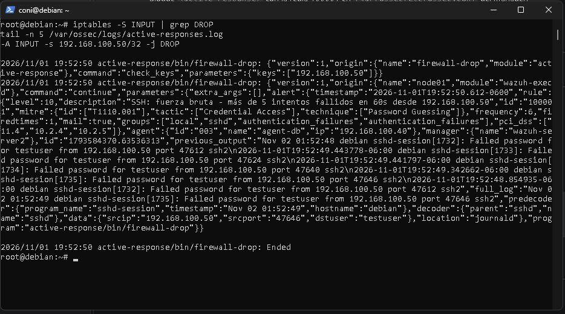
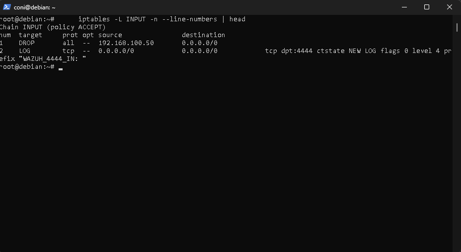

# PB-01 — Respuesta a fuerza bruta SSH

| Campo | Contenido |
|---|---|
| **ID / Versión** | PB-01 v1.0 |
| **Autor / Fecha** | Kendall Salazar, Joselyn Morales, Angelo Marín, Marconi Calvo, Juan Camacho  / 1-11-2026|
| **Disparador** | Alerta Wazuh **100001**: más de 5 intentos fallidos de SSH en 60 s desde la misma IP |
| **Activos cubiertos** | linux-server, agent-db |
| **Severidad** | Alta (nivel 10). Crítica si hay un login exitoso posterior desde la misma IP |
| **MITRE ATT&CK** | T1110.001 — Brute Force: Password Guessing (Credential Access) |
| **Marco de referencia** | NIST SP 800-61 (Preparación, Detección y Análisis, Contención, Erradicación, Recuperación, Lecciones aprendidas) |
| **Responsable** | Analista SOC. Escala al responsable de seguridad si hay acceso exitoso |
| **Objetivo de tiempo** | Detección a contención automática: menos de 1 minuto. Triage humano: menos de 15 minutos |

---

## 1. Qué automatiza Wazuh y qué hace el analista

| Etapa | Automático (ya configurado) | Manual (analista) |
|---|---|---|
| Detección | Regla 100001 en `local_rules.xml` | Revisar la alerta |
| Notificación | Integración Slack (nivel 10+) | Confirmar recepción |
| Contención | Active Response `firewall-drop` (600 s) sobre la IP origen | Decidir si extender el bloqueo |
| Enriquecimiento | Integración MISP: si la IP es un IoC conocido, alerta 100050 | Revisar el evento MISP asociado |
| Análisis | — | Verificar si hubo acceso exitoso |
| Erradicación y recuperación | — | Solo si hubo compromiso |

---

## 2. Preparación (requisitos previos)

- Agentes `linux-server` y `agent-db` activos en Wazuh (`/var/ossec/bin/agent_control -l`).
- `auth.log` recolectado por el agente (rsyslog instalado).
- Bloque `<active-response>` con la regla 100001 en `/var/ossec/etc/ossec.conf` del manager.
- Lista blanca (`<white_list>`) con la IP de administración y la del manager.
- Webhook de Slack operativo.
- Evidencia y comandos de este playbook accesibles al analista.

---

## 3. Detección y triage (0 a 5 min)

1. Recibir la alerta en Slack o verla en el Dashboard: **Threat Hunting → Events**, filtro `rule.id:100001`.
2. Identificar en la alerta los datos necesarios para el análisis y el registro posterior:
   - La IP de origen (`data.srcip`)
   - El agente atacado (`agent.name`)
   - El usuario objetivo (`data.dstuser`)
   - La hora de la alerta
3. Confirmar que el bloqueo automático se aplicó (en el agente atacado):
   ```bash
   iptables -S INPUT | grep DROP
   tail -n 5 /var/ossec/logs/active-responses.log
   ```
   
   
   Debe aparecer una regla `-A INPUT -s <IP_ATACANTE>/32 -j DROP`. El marcador `<IP_ATACANTE>` representa la dirección obtenida de la alerta.
4. Revisar si la IP está en MISP: buscar alerta `rule.id:100050` con la misma IP.

---

## 4. Análisis (5 a 20 min)

Pregunta clave: **¿el atacante logró entrar?** En el agente atacado:
```bash
grep "Accepted" /var/log/auth.log | grep <IP_ATACANTE>
last -i | head -n 20
```
En el Dashboard: `data.srcip:<IP_ATACANTE> AND rule.groups:authentication_success`.

| Resultado | Decisión |
|---|---|
| Sin login exitoso | Intento fallido. Ir a la sección 5A y cerrar |
| Con login exitoso | **Incidente confirmado.** Escalar y seguir en la sección 5B |

---

## 5. Contención

### 5A. Sin compromiso
1. Mantener el bloqueo automático.
2. Si el ataque se repite al expirar el bloqueo, bloquear de forma permanente:
   ```bash
   iptables -I INPUT -s <IP_ATACANTE> -j DROP
   ```
3. Cerrar el caso utilizando la guía de registro de la sección 9.

### 5B. Con compromiso
1. Bloquear la IP de forma permanente (comando anterior).
2. Bloquear la cuenta comprometida y cerrar sus sesiones:
   ```bash
   usermod -L <usuario>
   pkill -KILL -u <usuario>
   ```
3. Aislar el equipo si hay actividad sospechosa adicional.
4. **Preservar evidencia antes de cambiar nada** (sección 8).

---

## 6. Erradicación (solo si hubo compromiso)

1. Buscar persistencia:
   ```bash
   crontab -l -u <usuario>
   cat /home/<usuario>/.ssh/authorized_keys
   ls -la /etc/cron.d/ /etc/systemd/system/ | head -n 40
   ```
2. Revisar alertas FIM del agente: `/etc/passwd` y `/etc/sudoers` (regla 100002), `/usr/bin`, `/var/www` (regla 100060).
3. Revisar usuarios nuevos y procesos extraños:
   ```bash
   awk -F: '$3>=1000 {print $1}' /etc/passwd
   ps auxf | head -n 40
   ss -tnp
   ```
4. Eliminar lo malicioso encontrado y cambiar las credenciales de la cuenta afectada.

---

## 7. Recuperación

1. Restaurar desde snapshot o backup limpio si no se puede garantizar la integridad.
2. Rehabilitar la cuenta con una contraseña nueva: `usermod -U <usuario>`.
3. Monitorear 72 horas: alertas con `data.srcip:<IP_ATACANTE>` y actividad de la cuenta afectada.
4. Confirmar que el bloqueo expira correctamente y que el servicio queda operativo.

---

## 8. Evidencia a conservar

```bash
mkdir -p /root/ir-$(date +%F) && cd /root/ir-$(date +%F)
cp /var/log/auth.log* .
last -i > last.txt
who > who.txt
ps auxf > ps.txt
ss -tnp > conexiones.txt
iptables -S > iptables.txt
cp /var/ossec/logs/active-responses.log .
```
También: exportar las alertas del Dashboard (CSV) y guardar capturas de pantalla (alerta 100001, bloqueo, alerta MISP, mensaje de Slack).

---

## 9. Guía para documentar el incidente

Esta sección explica qué información debe contener el registro del incidente y la finalidad de cada elemento. El registro se construye con los datos observados durante la detección, el análisis, la contención y la recuperación; esta guía no constituye un formulario para completar dentro del playbook.

| Elemento que debe incluir el registro | Información que se debe documentar | Finalidad |
|---|---|---|
| Identificador del incidente | Identificador único asignado según la nomenclatura institucional, como `IR-2026-001`. | Permite localizar, relacionar y dar seguimiento al caso sin confundirlo con otros incidentes. |
| Fecha y hora de detección | Momento en que Wazuh generó la alerta o el analista identificó el ataque, incluida la zona horaria. | Establece el inicio de la línea de tiempo y permite medir el tiempo de respuesta. |
| Fecha y hora de contención | Momento en que se confirmó el bloqueo de la IP, el aislamiento del activo u otra medida de contención. | Demuestra cuándo se redujo el riesgo y permite comprobar el cumplimiento del objetivo de contención. |
| Tiempo de detección a contención | Diferencia entre la detección y la contención, expresada en minutos. | Permite evaluar el desempeño del playbook frente al objetivo de menos de 1 minuto para la contención automática. |
| IP atacante | Dirección IP registrada en `data.srcip`. | Identifica el origen observado, permite correlacionar eventos y verificar bloqueos o reincidencias. |
| Relación con MISP | Resultado de la búsqueda de la IP en MISP y, cuando exista coincidencia, el identificador del evento correspondiente. | Documenta si la IP estaba asociada con un indicador de compromiso y respalda el enriquecimiento de la alerta. |
| Activo afectado | Nombre del agente, servidor o servicio atacado, como `linux-server` o `agent-db`. | Define el alcance del incidente y facilita localizar la evidencia y las acciones aplicadas. |
| Usuario objetivo | Usuario indicado en `data.dstuser` y, si aplica, la cuenta que consiguió autenticarse. | Permite determinar qué cuenta fue objetivo o pudo quedar comprometida y orientar las medidas de protección. |
| Resultado de la autenticación | Conclusión basada en los eventos `Accepted`, `last -i` y el Dashboard sobre si hubo acceso exitoso. | Distingue un intento fallido de un compromiso confirmado y determina si corresponde escalar el incidente. |
| Acciones realizadas | Comandos y medidas ejecutadas, como bloqueo, aislamiento, bloqueo de cuenta, preservación de evidencia y cambios realizados. | Mantiene la trazabilidad técnica, evita repetir acciones y permite auditar la respuesta. |
| Resultado y estado | Estado final, como `Cerrado` o `Escalado`, junto con un resumen del resultado obtenido. | Indica si el incidente quedó resuelto o requiere investigación y seguimiento adicional. |
| Responsables | Analista que atendió el incidente y, si se escaló, responsable que lo recibió. | Establece la responsabilidad operativa y facilita solicitar aclaraciones o continuar el seguimiento. |

---

## 10. Lecciones aprendidas y mejoras

- Deshabilitar el login de root por SSH y el acceso por contraseña (hardening CIS, Fase 6).
- Autenticación por llaves, `AllowUsers` y MFA donde sea posible.
- Ajustar el umbral de la regla 100001 si genera falsos positivos.
- Revisar que la lista blanca incluye a los administradores legítimos.
- Documentar el tiempo real de respuesta y compararlo con el objetivo.

---

## 11. Prueba del playbook (ejercicio de validación)

La validación debe comprobar el flujo completo de detección, notificación, contención, análisis y documentación:

1. Generar desde Kali varios intentos fallidos contra el servicio SSH del agente de prueba; se espera la alerta 100001 en el Dashboard.
2. Confirmar la recepción del mensaje correspondiente en Slack.
3. Revisar en el agente la salida de `iptables -S INPUT | grep DROP`; debe observarse el bloqueo de la IP de Kali.
4. Buscar `rule.id:100050` para comprobar el enriquecimiento con MISP cuando la IP esté registrada como indicador.
5. Consultar los eventos de autenticación con `grep Accepted /var/log/auth.log | grep <IP_KALI>`; en una prueba sin compromiso no deben existir accesos aceptados.
6. Verificar que el registro incluya la información descrita en la sección 9 y que el caso quede documentado como cerrado cuando corresponda.
7. Esperar el tiempo de expiración configurado y comprobar en `iptables -S INPUT` que el bloqueo automático desaparezca.

Los marcadores entre `< >` representan datos obtenidos durante la prueba o la alerta; no son espacios destinados a completarse en este documento.