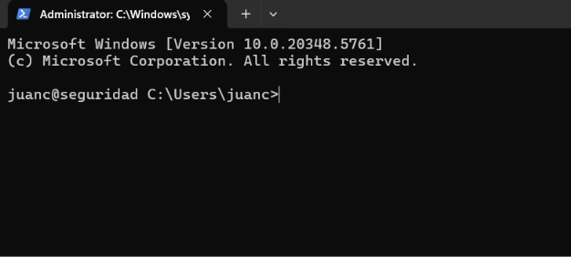

# Acceso SSH a Windows Server

## Instalación y activación de OpenSSH

Ejecutar desde PowerShell administrativo en la VM durante la preparación inicial:

```powershell
Get-WindowsCapability -Online | Where-Object Name -like 'OpenSSH*'
Add-WindowsCapability -Online -Name OpenSSH.Server~~~~0.0.1.0
Start-Service sshd
Set-Service sshd -StartupType Automatic
Get-Service sshd | Format-Table Name,Status,StartType
```

La conexión se realizó a través de la dirección ZeroTier `192.168.100.30`.



---


Los primeros intentos mezclaron comandos de PowerShell, comandos de Linux (`mkdir -p` y `cat`) y Notepad en la sesión SSH. El procedimiento se corrigió identificando el equipo y el intérprete antes de ejecutar cada bloque. Un prompt que comienza por `PS` puede ser local o remoto.

## Acceso SSH sin contraseña

La VM se configuró con el usuario `juanc` y la IP de laboratorio `192.168.100.30`. El acceso inicial se realizó mediante el archivo RDP local `seguridad.rdp` y la contraseña de la cuenta.

La clave Ed25519 utilizada se encuentra en el equipo local:

- Clave privada: `$env:USERPROFILE\.ssh\id_ed25519`.
- Clave pública: `$env:USERPROFILE\.ssh\id_ed25519.pub`.

La clave privada no se copia a la VM ni se guarda en el repositorio.

### Copiar la clave pública

Desde PowerShell en el equipo local, copiar la clave pública a la carpeta personal de la VM:

```powershell
scp -O "$env:USERPROFILE\.ssh\id_ed25519.pub" juanc@192.168.100.30:./id_ed25519.pub
```

Introducir la contraseña de `juanc` cuando SCP la solicite. En este servidor se comprobó que `-O` funcionó y que una transferencia sin esa opción se cerró; no es una exigencia general para Windows.

### Instalar la clave en Windows

Conectarse una vez por SSH usando la contraseña:

```powershell
ssh juanc@192.168.100.30
```

Para esta cuenta administrativa funcionó `%ProgramData%\ssh\administrators_authorized_keys`. Antes de aplicar el procedimiento en otro servidor, comprobar su `sshd_config` y la pertenencia a grupos; el archivo RDP no demuestra esos permisos.

Desde la consola remota cmd, iniciar PowerShell:

```cmd
C:\Windows\System32\WindowsPowerShell\v1.0\powershell.exe -NoProfile
```

El siguiente bloque es una referencia para instalar una clave pública en la ruta administrativa sin sobrescribir otras claves. El acceso de esta VM ya funciona; no repetirlo para continuar las tareas del dominio. Ejecutarlo solo en PowerShell remoto administrativo y tras verificar la ruta efectiva:

```powershell
try {
    $taskPublicKey = (Get-Content -LiteralPath "$env:USERPROFILE\id_ed25519.pub" -ErrorAction Stop).Trim()
    if ($taskPublicKey -isnot [string] -or $taskPublicKey -notmatch '^ssh-ed25519\s+\S+') {
        throw 'La clave publica debe ser una sola linea Ed25519.'
    }
    $taskKeyFile = Join-Path $env:ProgramData 'ssh\administrators_authorized_keys'
    $taskExistingKeys = if (Test-Path -LiteralPath $taskKeyFile) { @(Get-Content -LiteralPath $taskKeyFile -ErrorAction Stop) } else { @() }
    if ($taskExistingKeys -notcontains $taskPublicKey) {
        if ((Test-Path -LiteralPath $taskKeyFile) -and (Get-Item -LiteralPath $taskKeyFile).Length -gt 0) {
            Add-Content -LiteralPath $taskKeyFile -Value '' -Encoding ascii -ErrorAction Stop
        }
        Add-Content -LiteralPath $taskKeyFile -Value $taskPublicKey -Encoding ascii -ErrorAction Stop
    }
    $taskKeyAcl = New-Object System.Security.AccessControl.FileSecurity
    $taskKeyAcl.SetAccessRuleProtection($true, $false)
    foreach ($taskSidText in @('S-1-5-32-544', 'S-1-5-18')) {
        $taskSid = New-Object System.Security.Principal.SecurityIdentifier($taskSidText)
        $taskRule = New-Object System.Security.AccessControl.FileSystemAccessRule($taskSid, 'FullControl', 'Allow')
        $taskKeyAcl.AddAccessRule($taskRule)
    }
    $taskKeyAcl.SetOwner((New-Object System.Security.Principal.SecurityIdentifier('S-1-5-32-544')))
    Set-Acl -LiteralPath $taskKeyFile -AclObject $taskKeyAcl -ErrorAction Stop
} catch {
    throw
}
```

Para una cuenta no administrativa, consultar la ruta de su perfil que indique la configuración de OpenSSH. No copiar la clave privada. La instalación histórica de esta VM se confirmó con la conexión posterior; el bloque anterior es una revisión del procedimiento y no se ha vuelto a ejecutar contra el servidor.

Si se abrió PowerShell dentro de cmd, `exit` sale primero de PowerShell; otro `exit` cierra la sesión SSH. Esperar a recuperar la consola del equipo local antes del siguiente paso. También puede abrirse una segunda ventana local para comprobar el acceso conservando la sesión remota disponible.

### Conectarse sin contraseña

Desde el PowerShell local, probar la autenticación mediante clave pública:

```powershell
ssh -o PreferredAuthentications=publickey -o PasswordAuthentication=no juanc@192.168.100.30
```

También se puede indicar explícitamente la clave:

```powershell
ssh -i "$env:USERPROFILE\.ssh\id_ed25519" juanc@192.168.100.30
```

### Consideraciones

- Los comandos `New-Item` y `Get-Content` pertenecen a PowerShell; no funcionan en `cmd.exe`.
- En `cmd.exe` se usa `%USERPROFILE%`; para los cmdlets de esta guía debe iniciarse PowerShell o invocarlo con `-Command`.
- La clave pública debe estar en una sola línea dentro de `authorized_keys`.
- Si la autenticación falla, comprobar que el servicio `sshd` esté iniciado y que la clave se haya agregado al perfil correcto.
- La ruta de administrador puede diferir del perfil; revisar configuración y ACL antes de copiar la clave otra vez.
- Distinguir fallos al conectar del mensaje `Permission denied (publickey,...)`; una restricción del entorno de herramientas puede bloquear la conexión antes de autenticar.

Fuentes: [claves OpenSSH de Windows](https://learn.microsoft.com/en-us/windows-server/administration/openssh/openssh_keymanagement) y [cambio de SCP a SFTP](https://www.openssh.org/txt/release-9.0).
