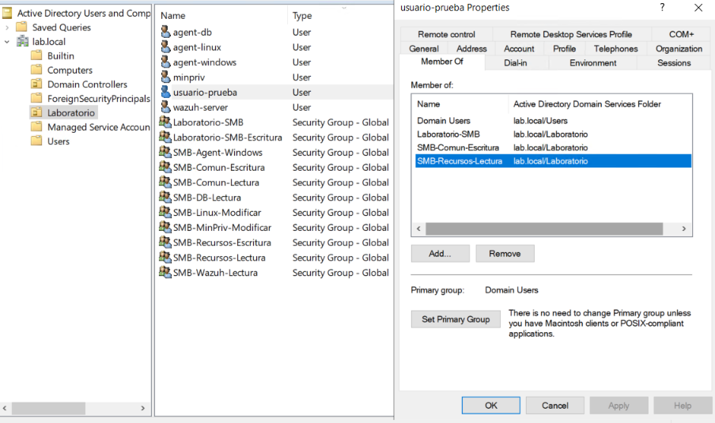
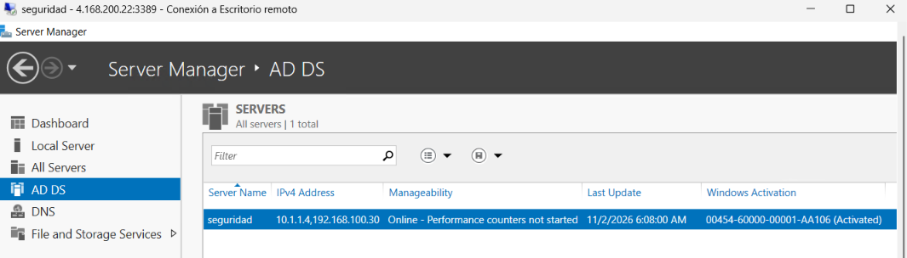
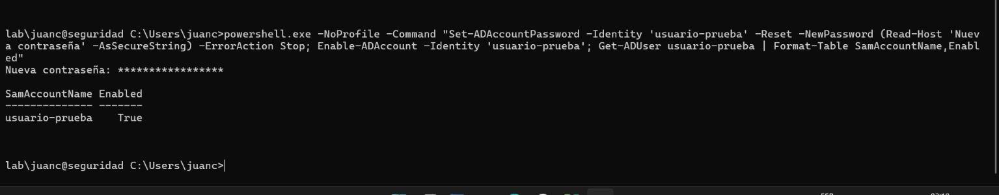

# Cuentas y grupos de Active Directory

La configuración se aplicó en `seguridad.lab.local` (`192.168.100.30`). Las cuentas pertenecen al dominio `LAB` y se organizan en la unidad de laboratorio.



## Cuentas de laboratorio

| Usuario LAB      | Función o grupo                           | Estado     | Contraseña          |
| ---------------- | ----------------------------------------- | ---------- | ------------------- |
| `usuario-prueba` | `SMB-Recursos-Lectura` + edición en comun | Habilitado | `Usuarioprueba123@` |
| `agent-windows`  | `SMB-Recursos-Escritura`                  | Habilitado | `Agentwindows1234@` |
| `wazuh-server`   | `SMB-Wazuh-Lectura`                       | Habilitado | `Wazuhlab12345678@` |
| `agent-linux`    | `SMB-Linux-Modificar`                     | Habilitado | `Agentlinux123456@` |
| `agent-db`       | `SMB-DB-Lectura`                          | Habilitado | `Agentdb123456789@` |
| `minpriv`        | `SMB-MinPriv-Modificar`                   | Habilitado | `Minpriv123456789@` |

Credenciales de prueba del laboratorio.

### Cuenta administrativa de laboratorio

| Cuenta | Contraseña de prueba |
| --- | --- |
| `LAB\juanc` | `ASDFG12345678910a!` |


## Grupos de seguridad

Los grupos globales documentados para el laboratorio son:

- `Laboratorio-SMB`
- `Laboratorio-SMB-Escritura`
- `SMB-Agent-Windows`
- `SMB-Comun-Escritura`
- `SMB-Comun-Lectura`
- `SMB-DB-Lectura`
- `SMB-Linux-Modificar`
- `SMB-MinPriv-Modificar`
- `SMB-Recursos-Escritura`
- `SMB-Recursos-Lectura`
- `SMB-Wazuh-Lectura`

Una cuenta puede pertenecer a varios grupos y acumular los permisos que cada grupo concede. La cuenta administrativa y las cuentas internas del dominio se conservan fuera de la limpieza de usuarios SMB.

## Controlador de dominio

- Nombre de equipo: `seguridad`.
- Nombre DNS: `seguridad.lab.local`.
- Unidad organizativa de referencia: `OU=Laboratorio,DC=lab,DC=local`.



## Registro inicial de creación de usuarios

### Creación del bosque y del dominio

Desde la consola remota se inició PowerShell para crear `lab.local`, con nombre NetBIOS `LAB` e instalación de DNS:

```cmd
C:\Windows\System32\WindowsPowerShell\v1.0\powershell.exe -NoProfile -Command "Install-ADDSForest -DomainName 'lab.local' -DomainNetbiosName 'LAB' -InstallDNS"
```


Se introdujo y confirmó la contraseña del modo de restauración, oculta en la captura, y se confirmó la operación. La salida muestra `Operation completed successfully`, contexto `DCPromo.General.3`, `RebootRequired: False` y estado `Success`.

Durante la instalación aparecieron advertencias sobre:

- La configuración de compatibilidad de algoritmos criptográficos con Windows NT 4.0.
- Al menos un adaptador físico sin direcciones IP estáticas configuradas.
- La imposibilidad de crear una delegación DNS porque no se encontró la zona principal autoritativa o no ejecutaba DNS de Windows.

### Habilitación de usuario-prueba

La sesión `lab\juanc@seguridad` muestra el restablecimiento de contraseña, la habilitación de la cuenta y la consulta de su estado:

```powershell
powershell.exe -NoProfile -Command "Set-ADAccountPassword -Identity 'usuario-prueba' -Reset -NewPassword (Read-Host 'Nueva contraseña' -AsSecureString) -ErrorAction Stop; Enable-ADAccount -Identity 'usuario-prueba'; Get-ADUser usuario-prueba | Format-Table SamAccountName,Enabled"
```



El resultado fue `SamAccountName: usuario-prueba` y `Enabled: True`. Aunque el archivo se llama `creacion-usuario-prueba.png`, muestra la habilitación de una cuenta existente, no el comando que creó el objeto.

### Usuarios y grupos iniciales

La creación se registró en `Herramientas > Active Directory Users and Computers > lab.local > Laboratorio`. Para consultar pertenencias: `usuario-prueba > Member Of`.

```csv
Name,Type,Description
Laboratorio-SMB,Security Group - Global,
Laboratorio-SMB-Escritura,Security Group - Global,
usuario-prueba,User,
verif-escritura-1028,User,Verificacion SMB 2026-10-28
verif-lectura-1028,User,Verificacion SMB 2026-10-28
```

Las cuentas `verif-escritura-1028` y `verif-lectura-1028` se utilizaron en la comprobación inicial. Su estado posterior no quedó registrado.

## Ubicación y acceso Dial-in

| Opción | Valor registrado |
| --- | --- |
| Ubicación | Vacío |
| Network Access Permission | Control access through NPS Network Policy |
| Allow access / Deny access | Sin seleccionar |
| Callback Options | No Callback |
| Set by Caller / Always Callback to | Sin seleccionar |
| Verify Caller-ID | Sin valor registrado |
| Assign Static IP Addresses | Opción visible; sin direcciones registradas |
| Apply Static Routes | Opción visible; sin rutas registradas |

