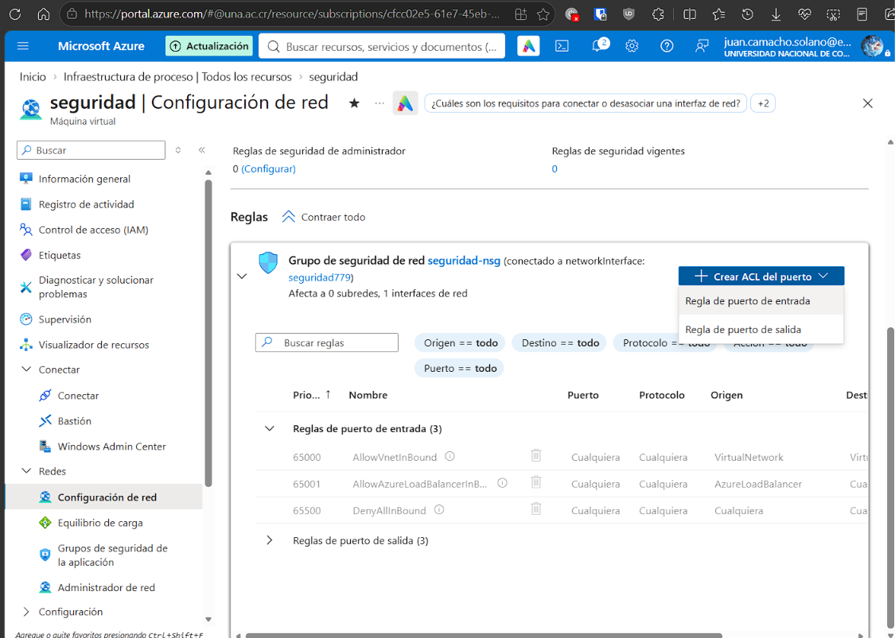
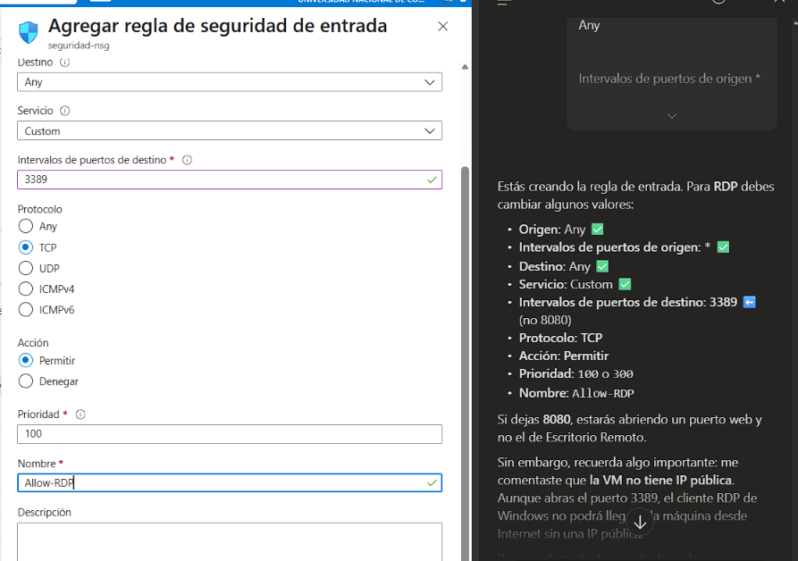
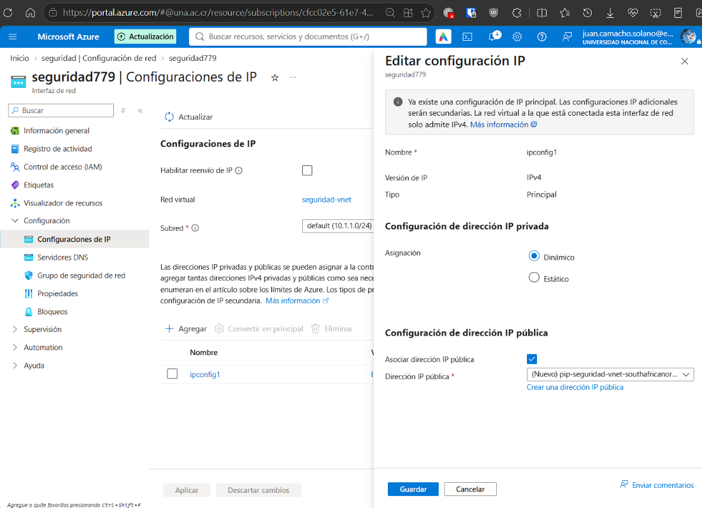
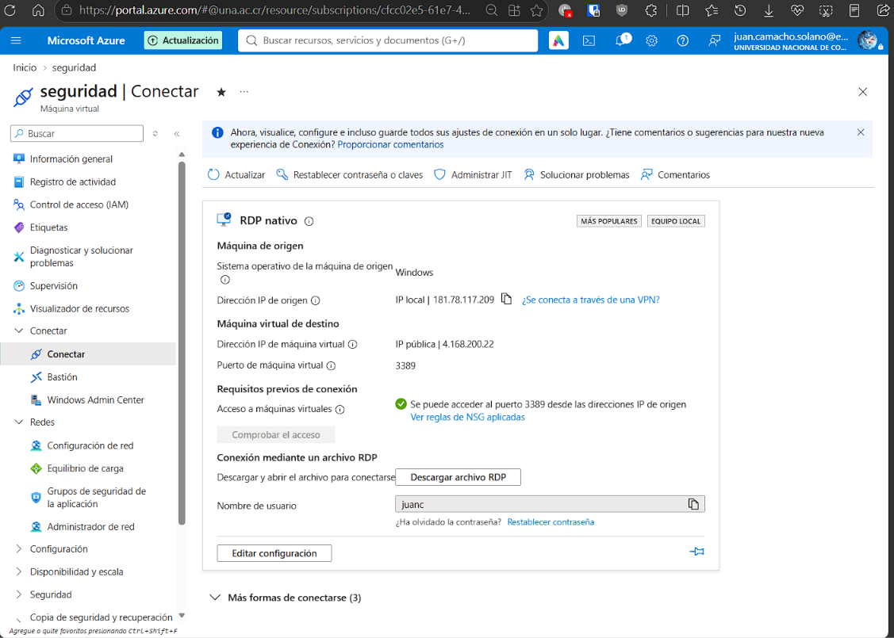
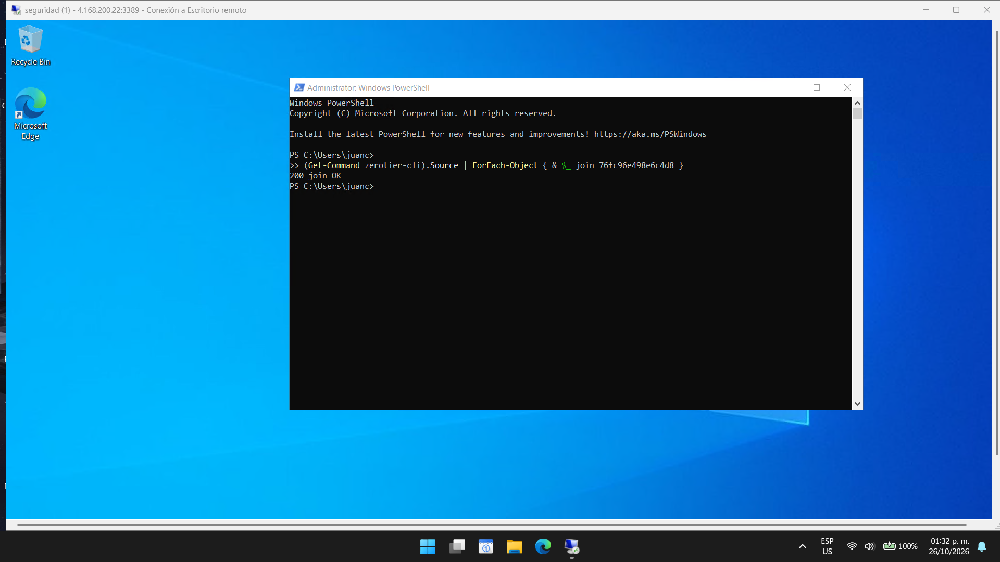

# Despliegue de Windows Server en Azure y acceso RDP

## Creación de la máquina virtual

Se utilizó la VM `seguridad` para el servidor Windows del laboratorio. La preparación inicial, registrada el 2026-10-26, contempla crearla dentro de una suscripción gratuita y menciona un crédito de 200 dólares. Ese importe corresponde a la anotación de la bitácora; no acredita el saldo utilizado ni una oferta vigente.

## Regla de entrada para RDP

En la configuración de red de la VM se abrió el grupo de seguridad `seguridad-nsg`, asociado a la interfaz `seguridad779`, para agregar una regla de entrada.



La captura del formulario muestra estos valores:

| Campo | Valor |
| --- | --- |
| Destino | Any |
| Servicio | Custom |
| Puerto de destino | 3389 |
| Protocolo | TCP |
| Acción | Permitir |
| Prioridad | 100 |
| Nombre | Allow-RDP |



La imagen documenta los valores del formulario. La comprobación de conectividad aparece en la pantalla de conexión RDP.

## Asociación de IP pública

Se editó la configuración principal existente `ipconfig1` y se activó `Asociar dirección IP pública`.

La captura muestra la red `seguridad-vnet`, la subred `default (10.1.1.0/24)` y asignación dinámica para la IP privada.



## Conexión RDP

En `Conectar > RDP nativo`, Azure mostró la IP pública `4.168.200.22`, el puerto `3389` y una comprobación de acceso correcta desde el origen mostrado.



Se descargó el archivo `seguridad.rdp` y se inició sesión con `juanc`. La contraseña de prueba del laboratorio es `ASDFG12345678910a!`.

También se anotó un posible problema de conectividad al usar Bastion. No se registró un diagnóstico que confirmara su causa.

## Incorporación de la VM a ZeroTier

Desde PowerShell administrativo se ejecutó:

```powershell
(Get-Command zerotier-cli).Source | ForEach-Object { & $_ join 76fc96e498e6c4d8 }
```

La consola respondió `200 join OK`.



La dirección de laboratorio registrada para esta VM es `192.168.100.30`. La respuesta del comando confirma la solicitud de unión; no muestra por sí sola la autorización ni la asignación de esa dirección.
