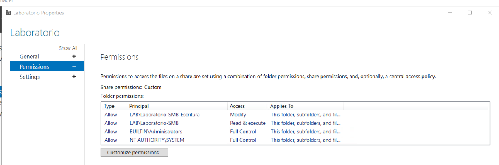
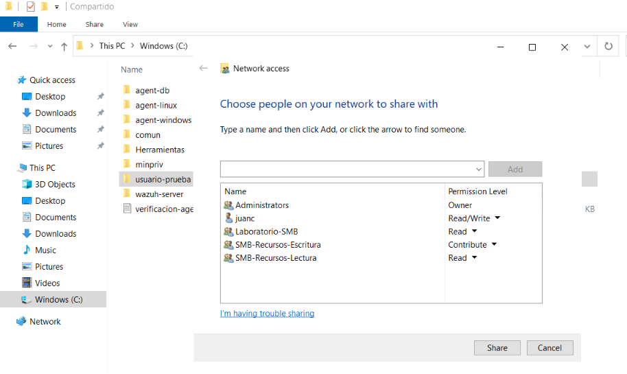

# Permisos SMB y NTFS

## Configuración inicial

La configuración inicial concedía acceso mediante `Laboratorio-SMB` y `Laboratorio-SMB-Escritura`. Posteriormente se añadieron los grupos de acceso global.

| Type  | Principal                     | Access         | Applies To                         |
| ----- | ----------------------------- | -------------- | ---------------------------------- |
| Allow | LAB\Laboratorio-SMB-Escritura | Modify         | This folder, subfolders, and files |
| Allow | LAB\Laboratorio-SMB           | Read & execute | This folder, subfolders, and files |
| Allow | BUILTIN\Administrators        | Full Control   | This folder, subfolders, and files |
| Allow | NT AUTHORITY\SYSTEM           | Full Control   | This folder, subfolders, and files |




## Asignaciones posteriores

### Permisos por carpeta

Las rutas son relativas a `C:\Laboratorio\Compartido`. Estas concesiones se complementan con los permisos globales de la sección siguiente.

| Grupo                   | Miembros         | Alcance                  | SMB    | NTFS                      |
| ----------------------- | ---------------- | ------------------------ | ------ | ------------------------- |
| `Laboratorio-SMB`       | `usuario-prueba` | Carpeta `usuario-prueba` | Read   | ReadAndExecute            |
| `SMB-Agent-Windows`     | `agent-windows`  | Carpeta `agent-windows`  | Read   | ReadAndExecute            |
| `SMB-Wazuh-Lectura`     | `wazuh-server`   | Carpeta `wazuh-server`   | Read   | ReadAndExecute            |
| `SMB-Linux-Modificar`   | `agent-linux`    | Carpeta `agent-linux`    | Change | Modificación de contenido |
| `SMB-DB-Lectura`        | `agent-db`       | Carpeta `agent-db`       | Read   | ReadAndExecute            |
| `SMB-MinPriv-Modificar` | `minpriv`        | Carpeta `minpriv`        | Change | Modificación de contenido |

### Permisos globales

| Grupo                    | Miembro          | Alcance                                            | SMB    | NTFS                                             |
| ------------------------ | ---------------- | -------------------------------------------------- | ------ | ------------------------------------------------ |
| `SMB-Recursos-Lectura`   | `usuario-prueba` | Raíz, todas las carpetas y archivos de Laboratorio | Read   | ReadAndExecute                                   |
| `SMB-Recursos-Escritura` | `agent-windows`  | Raíz, todas las carpetas y archivos de Laboratorio | Change | Leer y crear en carpetas; Modify en su contenido |

Resultado efectivo:

- `agent-windows` puede leer, crear, editar y eliminar contenido en todo el recurso; conserva sus grupos de carpeta propia y de escritura en `comun`.
- `usuario-prueba` puede leer todos los recursos. Solo puede editar en `comun`, mediante `SMB-Comun-Escritura`.
- Las cuentas restantes conservan el acceso a su carpeta y a `comun`.
- Los permisos globales se aplicaron también a carpetas con ACL protegidas y archivos existentes. Los archivos nuevos heredan las concesiones correspondientes.
- Las carpetas superiores conservan protección frente a eliminación por los grupos de modificación.
- `Administrators` conserva SMB Full y NTFS FullControl; `SYSTEM` tiene control total local NTFS. No se concedieron permisos administrativos a las cuentas SMB.

### Grupos independientes de la carpeta común

| Grupo                 | Miembros actuales                                           | Acceso en comun                                                       |
| --------------------- | ----------------------------------------------------------- | --------------------------------------------------------------------- |
| `SMB-Comun-Lectura`   | `wazuh-server`, `agent-db`                                  | SMB Read; NTFS ReadAndExecute                                         |
| `SMB-Comun-Escritura` | `usuario-prueba`, `agent-windows`, `agent-linux`, `minpriv` | SMB Change; lectura y escritura en la carpeta, Modify en su contenido |

El grupo de escritura incluye lectura y listado. Una cuenta puede pertenecer a varios grupos y acumular sus permisos.

```powershell
# Dar edición en comun a un usuario.
Add-ADGroupMember -Identity 'SMB-Comun-Escritura' -Members 'usuario-prueba'

# Alternativa: dejar a usuario-prueba con lectura en comun.
Add-ADGroupMember -Identity 'SMB-Comun-Lectura' -Members 'usuario-prueba'
Remove-ADGroupMember -Identity 'SMB-Comun-Escritura' -Members 'usuario-prueba' -Confirm

Get-ADGroupMember -Identity 'SMB-Comun-Lectura'
Get-ADGroupMember -Identity 'SMB-Comun-Escritura'
```

Son alternativas de referencia. La configuración vigente conserva edición en `comun` para `usuario-prueba`. En `agent-windows`, retirar solo el grupo común de escritura no impediría editar allí, porque también tiene `SMB-Recursos-Escritura`.

## Evidencia de acceso de red por carpeta



La captura muestra acceso de red de `usuario-prueba`; no sustituye una consulta de las ACL NTFS. Las comprobaciones anteriores de aislamiento de `agent-windows` y `usuario-prueba` quedaron sustituidas por el alcance global autorizado.

