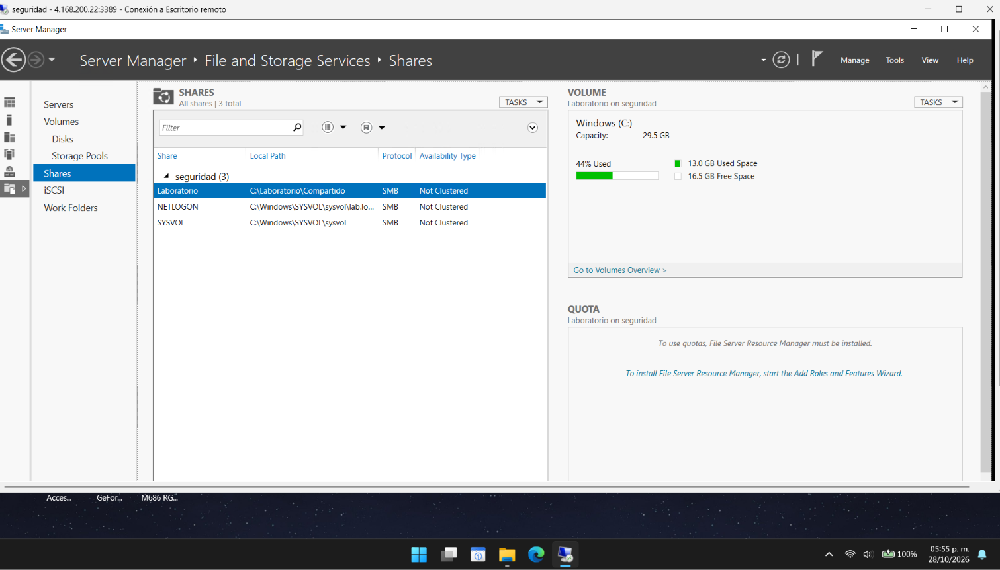
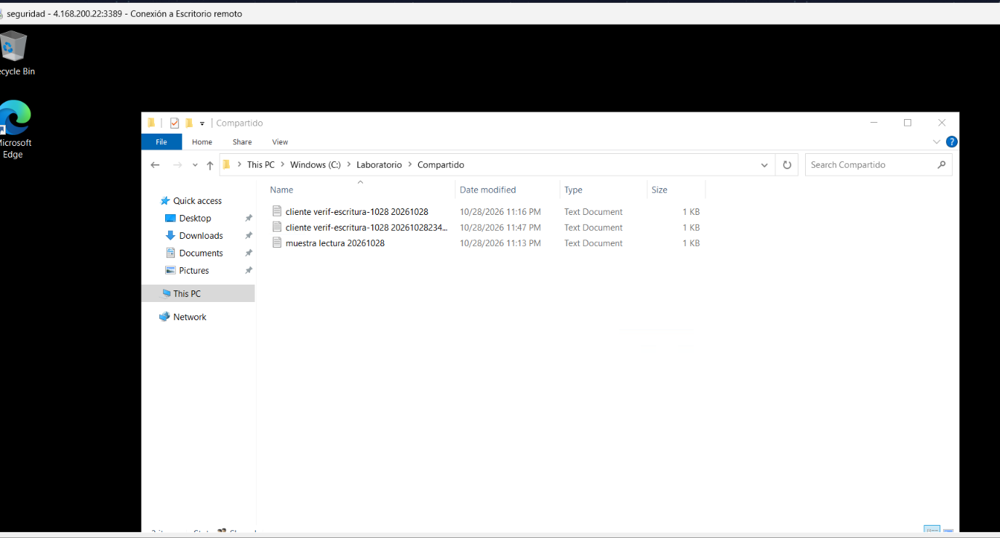
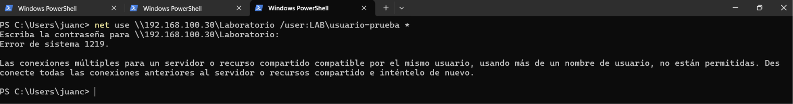
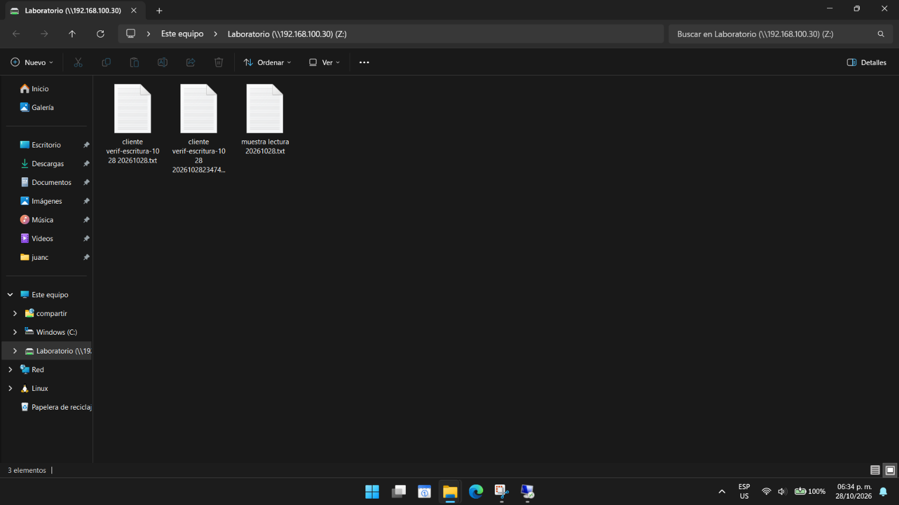

# Recurso compartido SMB

## Configuración

Se creó el recurso compartido `Laboratorio` con protocolo SMB y sin clúster. La carpeta compartida es `C:\Laboratorio\Compartido`.



La estructura de carpetas es:

```text
C:\Laboratorio\Compartido\
├── usuario-prueba\
├── agent-windows\
├── wazuh-server\
├── agent-linux\
├── agent-db\
├── minpriv\
└── comun\
```



La captura muestra archivos de una comprobación anterior, antes de la estructura por cuentas descrita arriba.

Cada cuenta tiene una carpeta propia y acceso a `comun`. `agent-windows` dispone de modificación global y `usuario-prueba` de lectura global y edición en `comun`.

## Conexión desde un cliente

Desde PowerShell, en un cliente conectado a ZeroTier, se puede solicitar una sesión con:

```powershell
net use \\192.168.100.30\Laboratorio /user:LAB\usuario-prueba *
```

Para otra cuenta, se sustituye `usuario-prueba` por el usuario autorizado. También se puede abrir en el Explorador:

```text
\\192.168.100.30\Laboratorio\agent-windows
\\192.168.100.30\Laboratorio\comun
```

Si Windows informa un conflicto de credenciales, se deben cerrar primero las conexiones activas a este servidor.





## Archivos de la comprobación inicial

La transcripción inicial de los archivos visibles fue: `cliente verif-escritura-1028 2261028`, `cliente verif-escrituraa-1028 2261028234747` y `muestra lectura maestra 20261028`. La transcripción contiene aparentes errores tipográficos; las capturas conservan los nombres visibles.

## Conexión por nombre DNS

Desde el Explorador también se accede a `\\seguridad.lab.local\laboratorio`, introduciendo las credenciales de laboratorio cuando se soliciten.

El `*` de `net use` solicita la contraseña. Ejemplo con la cuenta de acceso global:

```powershell
net use \\192.168.100.30\Laboratorio /user:LAB\agent-windows *
```

