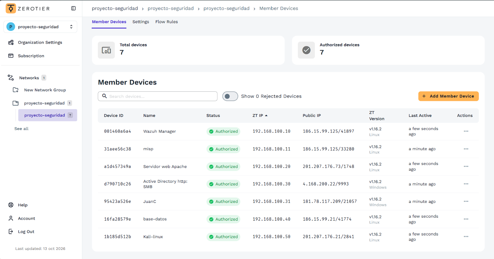

# Red SDN: ZeroTier y Tailscale

## Dispositivos del laboratorio

Instantánea de los siete dispositivos autorizados. Las direcciones, versiones y tiempos de actividad corresponden al momento de la captura.

| Device ID  | Name                       | Status       | ZT IP -        | Public IP            | ZT Version      | Last Active       |
| ---------- | -------------------------- | ------------ | -------------- | -------------------- | --------------- | ----------------- |
| 001460a6a4 | Wazuh Manager              | Autorizado | 192.168.100.10 | 186.15.50.125/41897  | v1.16.2 Linux   | a few seconds ago |
| 31aee56c38 | misp                       | Autorizado | 192.168.100.11 | 186.15.50.125/33280  | v0.16.2 Linux   | a minute ago      |
| a1d457349a | Servidor web Apache        | Autorizado | 192.168.100.20 | 201.207.176.73/1748  | v1.16.2 Linux   | a few seconds ago |
| d790710c26 | Active Directory http: SMB | Autorizado | 192.168.100.30 | 4.168.200.22/9993    | v1.16.2 Windows | a minute ago      |
| 95423a526e | JuanC                      | Autorizado | 192.168.100.31 | 181.78.117.209/21057 | v1.16.2 Windows | a minute ago      |
| 16fa28579e | base-datos                 | Autorizado | 192.168.100.40 | 186.15.50.21/41774   | v1.16.2 Linux   | a few seconds ago |
| 1b185d512b | Kali-linux                 | Autorizado | 192.168.100.50 | 201.207.176.21/2841  | v1.16.2 Linux   | a few seconds ago |

## Funcionamiento de ZeroTier

ZeroTier conecta equipos distribuidos mediante una LAN virtual de capa 2. Transporta tramas Ethernet, lo que permite comunicación local, broadcast y multicast entre dispositivos situados en redes distintas.

El funcionamiento se describió en tres etapas:

1. **Control:** ZeroTier Central, o un controlador autohospedado, administra la autenticación y autorización de miembros.
2. **Descubrimiento:** los nodos utilizan mecanismos de atravesamiento de NAT, comparados en el registro con STUN/ICE, para encontrarse a través de Internet.
3. **Comunicación:** los nodos pueden establecer túneles cifrados directos entre pares.

El registro atribuye a esta comunicación directa menor latencia al evitar intermediarios para los datos. No incluye mediciones ni una comprobación de conexión directa para cada dispositivo.

## Seguridad y administración

El análisis del laboratorio destaca la autorización de dispositivos, el cifrado y el aislamiento entre redes. Menciona Curve25519, ChaCha20, AES y ChaCha20/Poly1305; no documenta qué combinación utiliza la versión instalada.

La gestión de ZeroTier se describe mediante Node IDs de diez caracteres, con autorización o revocación individual desde el panel. Para autohospedaje se mencionan controladores y nodos Moons como componentes de infraestructura, con funciones distintas.

Tailscale se describe como una red mallada basada en WireGuard, integrada con proveedores de identidad como Google, Microsoft, GitHub y Okta. El registro vincula la baja del usuario en el proveedor con la pérdida de acceso; no incluye una prueba de revocación ni su tiempo efectivo.

## Comparación con una VPN manual

La configuración manual de WireGuard o de una VPN tradicional exige administrar claves, direcciones y rutas. El análisis también menciona apertura de puertos, DNS dinámico y reglas de cortafuegos, según la topología.

ZeroTier automatiza parte del descubrimiento y la conexión entre equipos detrás de NAT. El registro destaca la continuidad ante cambios de IP pública, sin aportar pruebas de todas las condiciones de red.

## Alternativas evaluadas

| Alternativa | Ventajas anotadas | Limitaciones anotadas |
| --- | --- | --- |
| Tailscale | Configuración sencilla, integración con proveedores de identidad y rendimiento de WireGuard | Capa 3; las aplicaciones que dependen de broadcast o multicast necesitan soluciones adicionales |
| WireGuard manual | Código sencillo, bajo consumo y control de claves, direcciones y rutas | Administración manual y posible infraestructura adicional para NAT complejos |
| OpenVPN | Amplia compatibilidad, varios métodos de autenticación y configuración flexible | Configuración más compleja y mayor sobrecarga según la comparación original |

Las valoraciones de velocidad y consumo son parte del análisis teórico; no se realizaron pruebas comparativas de rendimiento.

## ZeroTier frente a Tailscale

| Criterio | ZeroTier | Tailscale |
| --- | --- | --- |
| Capa de red | Capa 2: conmutador Ethernet virtual | Capa 3: enrutamiento de paquetes IP |
| Tráfico local | Broadcast y multicast; casos citados: mDNS, DLNA, juegos LAN, impresoras, escáneres y protocolos industriales | No extiende directamente una LAN Ethernet; pueden necesitarse proxies o soluciones específicas de subred |
| Protocolo | Protocolo propio en espacio de usuario | WireGuard |
| Rendimiento anotado | Muy bueno, con consumo adicional de CPU atribuido al espacio de usuario | Excelente, atribuido a WireGuard y su integración en Linux |
| Identidades | Node IDs autorizados en el panel | SSO con proveedores de identidad |
| Autohospedaje anotado | Controladores propios y componentes de infraestructura | Headscale como alternativa comunitaria al servidor de control oficial |
| Límites gratuitos citados | 10 dispositivos por cuenta | 6 usuarios y dispositivos ilimitados por usuario |

Los límites comerciales y las afirmaciones sobre implementación, licencias y rendimiento son datos del análisis inicial, pendientes de verificación para uso actual. El análisis también atribuye ausencia de límite de nodos al controlador autohospedado de ZeroTier; no documenta las condiciones que sustentan esa afirmación.

## Criterios de selección registrados

- **Tailscale:** conectar servidores, ordenadores, móviles y un homelab con administración sencilla e identidad federada. El análisis inicial favorecía su plan gratuito y rendimiento; ambas valoraciones quedaron sin comprobación.
- **ZeroTier:** extender comunicación de capa 2 para aplicaciones que dependen de descubrimiento local, broadcast o multicast, o administrar un controlador propio.
