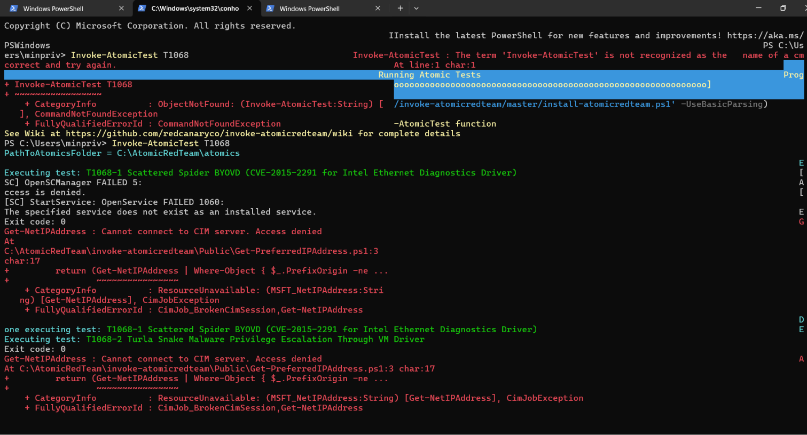
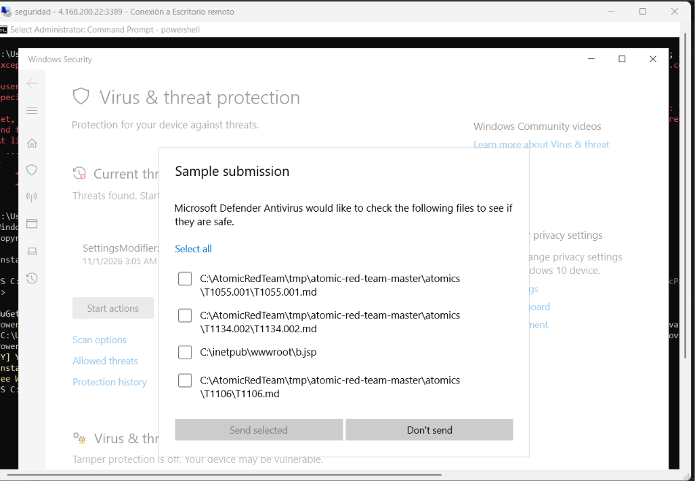
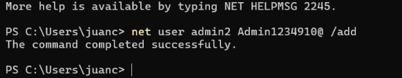

# Simulación de ataques en Windows

## Preparación de Atomic Red Team

Se registró la instalación de Atomic Red Team con sus pruebas:

```powershell
IEX (IWR 'https://raw.githubusercontent.com/redcanaryco/invoke-atomicredteam/master/install-atomicredteam.ps1' -UseBasicParsing)
Install-AtomicRedTeam -getAtomics -Force
```

La prueba utilizada fue `T1068`. Para consultar sus detalles:

```powershell
Invoke-AtomicTest T1068 -ShowDetails
```

## Ejecución con mínimo privilegio

- Cuenta: `LAB\minpriv`.
- Contraseña de laboratorio: `Minpriv123456789@`.

```powershell
Invoke-AtomicTest T1068
```



La captura muestra dos momentos de la ejecución:

1. PowerShell no reconoce inicialmente `Invoke-AtomicTest`.
2. En el intento posterior comienzan las pruebas `T1068-1` y `T1068-2`, pero aparecen errores al acceder a servicios y consultar CIM.

Se observan `OpenSCManager FAILED 5: Access is denied`, `OpenService FAILED 1060` y `Get-NetIPAddress: Cannot connect to CIM server. Access denied`. Aunque algunas líneas indican `Exit code: 0`, la salida contiene errores y no demuestra una escalada de privilegios exitosa.

El fallo se atribuyó inicialmente a la falta de permisos administrativos. La captura también muestra un servicio inexistente y el error inicial de carga del comando.

## Ejecución con privilegios de administrador

- Cuenta principal del laboratorio: `LAB\juanc`.
- Contraseña de laboratorio: `ASDFG12345678910a!`.

La prueba continuó en una consola elevada. El título de la ventana muestra `Administrator: Command Prompt - powershell`.



Microsoft Defender muestra una solicitud de envío de muestras que incluye:

- `C:\AtomicRedTeam\tmp\atomic-red-team-master\atomics\T1055.001\T1055.001.md`.
- `C:\AtomicRedTeam\tmp\atomic-red-team-master\atomics\T1134.002\T1134.002.md`.
- `C:\AtomicRedTeam\tmp\atomic-red-team-master\atomics\T1106\T1106.md`.
- `C:\inetpub\wwwroot\b.jsp`.

La imagen documenta la sesión elevada y la intervención de Defender. La ventana de seguridad oculta parte de la consola, por lo que no permite determinar el resultado completo de `T1068` ni atribuir todas las muestras a esa prueba.

## APTSimulator

Se registró el uso de la opción `0` de APTSimulator:

- [Publicaciones de APTSimulator](https://github.com/NextronSystems/APTSimulator/releases).
- [Archivo APTSimulator_pw_apt.zip, versión 0.9.4](https://github.com/NextronSystems/APTSimulator/releases/download/v0.9.4/APTSimulator_pw_apt.zip).
- Contraseña del archivo: `apt`.

No se conserva una salida completa de las acciones ejecutadas por esa opción.

## Creación de una cuenta durante la simulación



La consola confirma que se completó el comando de creación de `admin2`. La captura incluye su contraseña de prueba, pero no muestra una asignación a grupos administrativos.

## Comando adicional de administración

También se anotó el siguiente comando para la cuenta principal, sin salida que confirme su ejecución:

```powershell
net user juanc "ASDFG12345678910a!"
```
